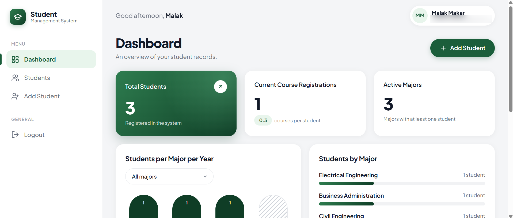
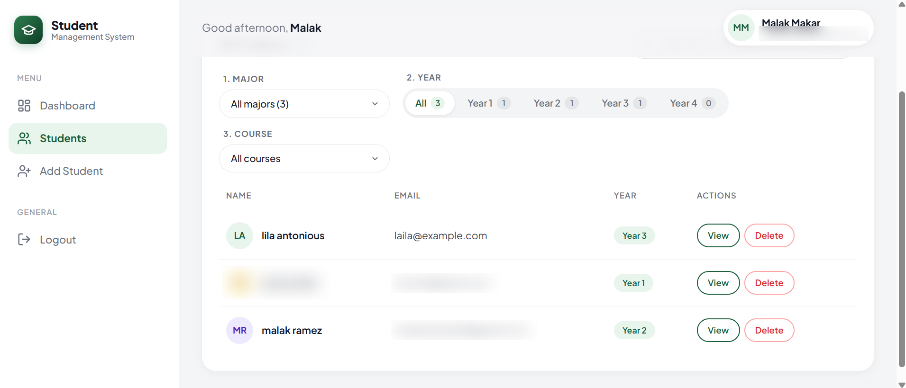
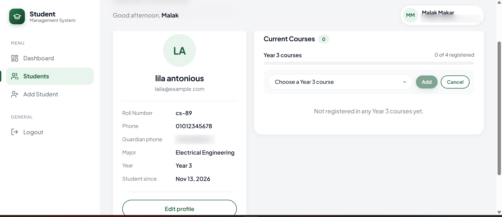
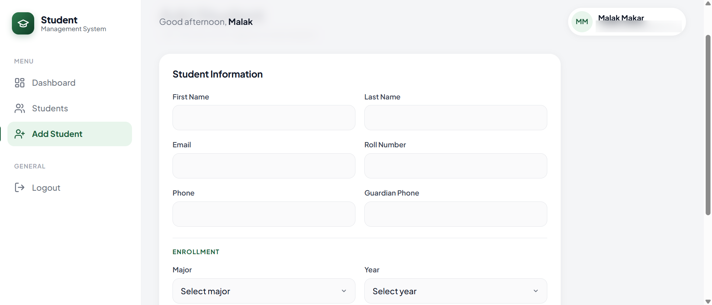
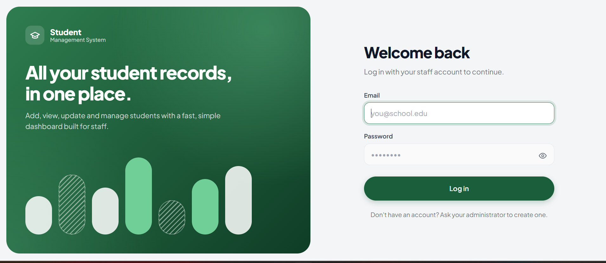

# Student Management System

A full-stack web app for school staff to manage student records: add students, register them in courses, and view, update and delete their records. It has a login for staff and a dashboard with live statistics.

Built as **Task 2** of the Auspify Technologies Full Stack Development Internship.

🎥 **Demo video:** [Watch the demo](https://drive.google.com/file/d/1uVqcJCzmrw2kH670Omq08zRsjo-BXe-V/view)

**Tech stack:** React 19 · React Router · Vite · Node.js · Express 5 · MongoDB (Mongoose) · JWT authentication

---

## Features

**Student records (CRUD)**
- **Add** a student with name, email, roll number, major, year and both their own and their guardian's phone number (both required and checked for a valid format). Picking a first course is optional: a student can be registered without any courses.
- **View** all students in a searchable table (one row per student: name, email, year), and open a student's profile to see their courses.
- **Update** a student's details with **Edit profile**.
- **Delete** a student (with all their courses) from the list, after a confirmation prompt.

**Courses and enrollment**
- Each major has its own course list for each year (1–4). A student can only register in courses for their major and current year.
- A student can take several courses, but never the same course twice (or a course they already completed).
- Add, change or remove a course right on the student's profile.

**Moving up a year**
- **Move to Year N** on the profile promotes the student to the next year. All of their current courses are automatically marked **completed** and kept in their history, and they can then register in the new year's courses.
- Year 4 is the final year.
- Major and year can't be changed by hand while the student has current courses, so their course list always matches their year.

**Student profile**
- Details card with **Edit profile** and **Move to next year**.
- **Current courses** with progress through that year's courses ("3 of 4 registered") and **Add course**.
- **Completed courses**, grouped by the year they were taken in.

**Finding students**
- Search by name, email, roll number, course or major.
- Filter step by step: **major → year → course**. Each option shows how many students match. The filters are saved in the URL, so a filtered list can be bookmarked or linked from the dashboard.

**Dashboard**
- Total students, current course registrations, and active majors.
- Charts of students per year (for all majors or one chosen major) and students per major (click either to open the filtered list), plus recently added students.

**Security**
- Staff log in with email and password. Passwords are hashed with bcrypt, and sessions use JSON Web Tokens (8-hour expiry). The login is kept only in memory (never saved in the browser), so the app always opens on the login page, including after a refresh.
- Every student and course route requires a valid token.
- Login gives the same error for an unknown email and a wrong password, so it doesn't reveal which emails have accounts.
- The server only accepts known fields and validates everything again on its side.

**Responsive design**
- Works on desktop, tablet and phone. On small screens the sidebar becomes a slide-in menu.

## Screenshots

| Dashboard | Students |
|---|---|
|  |  |

| Student profile | Add / edit student |
|---|---|
|  |  |

| Login |
|---|
|  |

## Project structure

```
student-management-system/
├── client/                    React frontend (Vite)
│   ├── src/
│   │   ├── api.js             All calls to the backend
│   │   ├── auth/              Login state and protected-route wrapper
│   │   ├── components/        Sidebar, student table, student form, icons
│   │   ├── hooks/useFlash.js  Success messages passed between pages
│   │   ├── layouts/           Sidebar + top bar around logged-in pages
│   │   └── pages/             Login, Dashboard, Students, Profile, Add/Edit
│   └── vercel.json            Lets page refreshes work when deployed
└── server/                    Express + MongoDB backend
    ├── app.js                 Routes, middleware and error handling
    ├── index.js               Connects to MongoDB and starts the server
    ├── data/courses.js        Course catalog: major → year → courses
    ├── middleware/            Login-token check
    ├── models/                Student and User (staff) schemas
    ├── routes/                /api/auth and /api/students
    ├── scripts/               Create staff accounts; one-time database upgrade
    └── tests/                 Automated API tests
```

## Getting started

### Requirements
- [Node.js](https://nodejs.org/) 20 or newer
- A MongoDB database. A free [MongoDB Atlas](https://www.mongodb.com/atlas) cluster works.

### 1. Set up the backend

```bash
cd server
npm install
```

Copy `server/.env.example` to `server/.env` and fill it in:

| Variable | What it is |
|---|---|
| `PORT` | Port for the API (default `5000`) |
| `MONGO_URI` | Your MongoDB connection string |
| `JWT_SECRET` | Any long random string, used to sign login tokens |
| `CLIENT_URL` | Production only: the deployed frontend's address. Leave it empty locally. |

Create a staff account to log in with:

```bash
npm run create-worker -- "Your Name" you@example.com "a-strong-password"
```

Running the same command again with an existing email resets that account's password.

Start the API:

```bash
npm run dev
```

You should see `MongoDB connected` and `Server running on http://localhost:5000`.

> **Upgrading from an older version?** Earlier versions stored one database record per course registration. Run `npm run migrate` once to combine them into one record per student. It saves a backup of the old records in `server/backups/` first, and running it again does nothing.

### 2. Set up the frontend

In a second terminal:

```bash
cd client
npm install
npm run dev
```

Open **http://localhost:5173** and log in with the account you created. During development, Vite forwards every `/api/...` request to the backend on port 5000, so no extra setup is needed.

## Running the tests

```bash
cd server
npm test
```

There are 37 automated tests, run with Node's built-in test runner and [Supertest](https://github.com/ladjs/supertest). They cover login and token checks, all student and course routes, validation errors (including required and invalid phone numbers), unique roll numbers and emails, the one-course-only-once rule, and moving a student up a year.

The tests use a temporary in-memory MongoDB ([mongodb-memory-server](https://github.com/typegoose/mongodb-memory-server)), so they **never touch your real database**. The first run downloads the MongoDB binary, which takes a minute.

## API reference

Every route except `/api/health` and `/api/auth/login` needs the header `Authorization: Bearer <token>`.

| Method | Route | Description |
|---|---|---|
| `GET` | `/api/health` | Check that the server is running |
| `POST` | `/api/auth/login` | Log in. Body: `{ email, password }`. Returns `{ token, user }` |
| `GET` | `/api/auth/me` | The logged-in staff member |
| `GET` | `/api/courses` | Course catalog: `{ major: { year: [courses] } }` |
| `GET` | `/api/students` | All students (each with their `courses`), newest first |
| `GET` | `/api/students/:id` | One student |
| `POST` | `/api/students` | Create a student. `course` is optional (their first course) |
| `PUT` | `/api/students/:id` | Update a student's details. Major and year can only change while they have no current courses |
| `DELETE` | `/api/students/:id` | Delete a student and all their courses |
| `POST` | `/api/students/:id/promote` | Move up a year: current courses become completed |
| `POST` | `/api/students/:id/courses` | Register in a course. Body: `{ course }` |
| `PUT` | `/api/students/:id/courses/:courseId` | Change a current course to another one. Body: `{ course }` |
| `DELETE` | `/api/students/:id/courses/:courseId` | Remove a course |

Example body for `POST /api/students` (`PUT` takes the same fields, without `course`):

```json
{
  "firstName": "Sara",
  "lastName": "Ali",
  "email": "sara.ali@example.com",
  "rollNumber": "R-100",
  "phone": "0100000000",
  "guardianPhone": "+20 122 333 4444",
  "major": "Computer Science",
  "year": 1,
  "course": "Calculus I"
}
```

The course routes and `promote` return the updated student.

Errors come back as `{ "message": "..." }` with a matching status code:

| Status | Meaning |
|---|---|
| `400` | Invalid data |
| `401` | Not logged in, or the session expired |
| `404` | Not found |
| `409` | Conflicts with an existing record (e.g. a roll number or email another student already has) |

### Data model

There is one **Student** document per student. Their courses are stored inside it as a `courses` list, where each entry has a `name`, the `year` it was taken in, and a `status`: `registered` (being taken now) or `completed` (set when the student moves up a year). Unique indexes on `rollNumber` and `email` stop two students from sharing either. The courses offered for each major and year live in `server/data/courses.js`; edit that file to change them.

## Deployment

The backend and frontend deploy separately. One common setup:

**Backend on [Render](https://render.com)** (Web Service)
1. Root directory: `server`. Build command: `npm install`. Start command: `npm start`.
2. Add the environment variables `MONGO_URI`, `JWT_SECRET` and `CLIENT_URL` (your frontend's address, set after step 2 of the frontend below).
3. In MongoDB Atlas → **Network Access**, allow connections from anywhere (`0.0.0.0/0`), since Render's IP addresses change.

**Frontend on [Vercel](https://vercel.com)**
1. Import the repository and set the root directory to `client`. Vercel detects Vite automatically.
2. Add the environment variable `VITE_API_URL` = your Render backend address, e.g. `https://your-api.onrender.com`.
3. Deploy, then put the Vercel address in `CLIENT_URL` on Render and redeploy the backend.

`client/vercel.json` makes refreshes on pages like `/students` load the app instead of a 404.

## Author

**Malak Makar** · Auspify Technologies Full Stack Development Internship · [GitHub](https://github.com/Malak02082005) · [LinkedIn](https://www.linkedin.com/in/makar-makar/)
